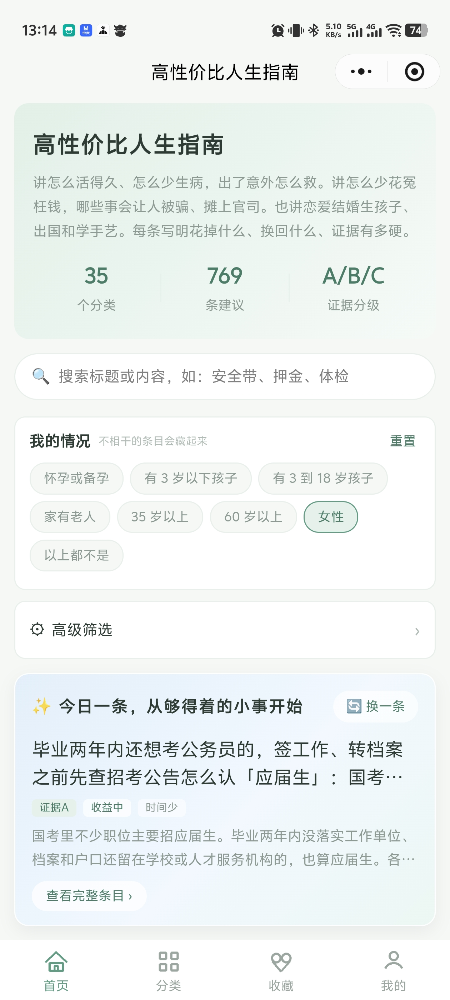
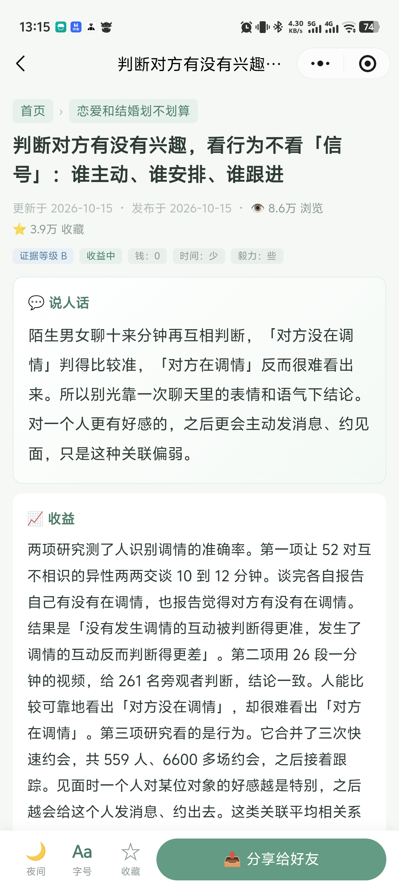

# ⚡ 高性价比人生指南小程序版 · 微信小程序
> **微信小程序 · 持续更新中**
>
> 把每一次消费和选择，都花在刀刃上。衣食住行、职场成长，用更少的预算，过更讲究的生活。

📱 微信内即点即用 ｜ 🧭 场景化攻略 ｜ 💡 实用决策清单 ｜ 🔄 内容持续更新

---

## 我们的小程序

*微信扫一扫下方二维码，或点击二维码在微信中打开*

### 🏠 高性价比人生指南攻略 `生活 · 攻略`

> **把每一次消费和选择，都花在刀刃上**

覆盖衣食住行、数码好物、健康学习等生活场景的性价比决策攻略合集。每一条都帮你算清「值不值」，少花冤枉钱、少踩坑，用更少的预算过更讲究的生活。

**特性**：多场景攻略 ｜ 避坑指南 ｜ 性价比决策清单 ｜ 持续更新

**开源项目**：[GitHub · eternity4719/HowToLiveBetter](https://github.com/eternity4719/HowToLiveBetter) `CC BY 4.0` —— 内容基于该项目整理

*微信扫码 · 即点即用*

> 页面截图

 

### 🚀 更多小程序，敬请期待

高性价比人生指南攻略将持续推出不同平台小程序，方便使用。

---

## 如何使用

| 方式 | 说明 |
| --- | --- |
| **STEP 01 · 扫一扫** | 打开微信「扫一扫」，扫描页面上对应小程序的二维码，即可直达 |
| **STEP 02 · 点击二维码** | 手机上点击二维码图片，若已配置微信跳转链接，将直接唤起微信打开小程序 |
| **STEP 03 · 搜索名称** | 在微信中搜索小程序名称「高性价比人生指南攻略」 |

---

## 开源署名

本站小程序内容基于开源项目 [HowToLiveBetter](https://github.com/eternity4719/HowToLiveBetter) 整理，均遵循 [CC BY 4.0](https://creativecommons.org/licenses/by/4.0/deed.zh) 协议署名传播，感谢开源作者。

---

*用更少的预算，过更讲究的生活 · © 2026 高性价比人生指南小程序版*
